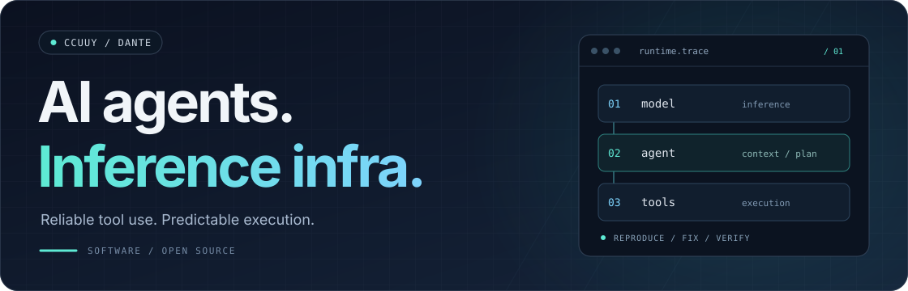
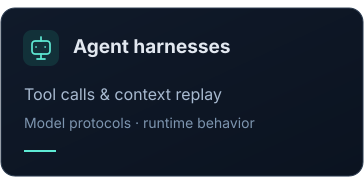
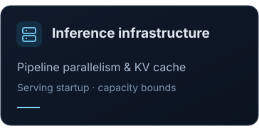
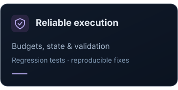

  

  
  
  
  

### Hi, I'm Dante.

Software engineer focused on **AI agents and inference infrastructure**. I'm interested in the runtime details that make agents useful: tool execution, context replay, execution budgets, and model serving.

  
  
  

### Selected open-source contributions

| Project | Contribution | Pull request |
| :--- | :--- | :--- |
| **[SGLang](https://github.com/sgl-project/sglang)** | Bound startup profiling by available KV-cache capacity, including the smaller SWA pool. Reproduced the original PP startup failure on two T4 GPUs. |  |
| **[OpenCode](https://github.com/anomalyco/opencode)** | Disambiguate reused tool-call IDs during Chat Completions and Responses replay, keeping results paired with their calls and stored history unchanged. |  |

### On my radar

Agent evaluation · Post-training · Agent security

---

  Reproduce the problem. Understand the runtime. Verify the fix.

